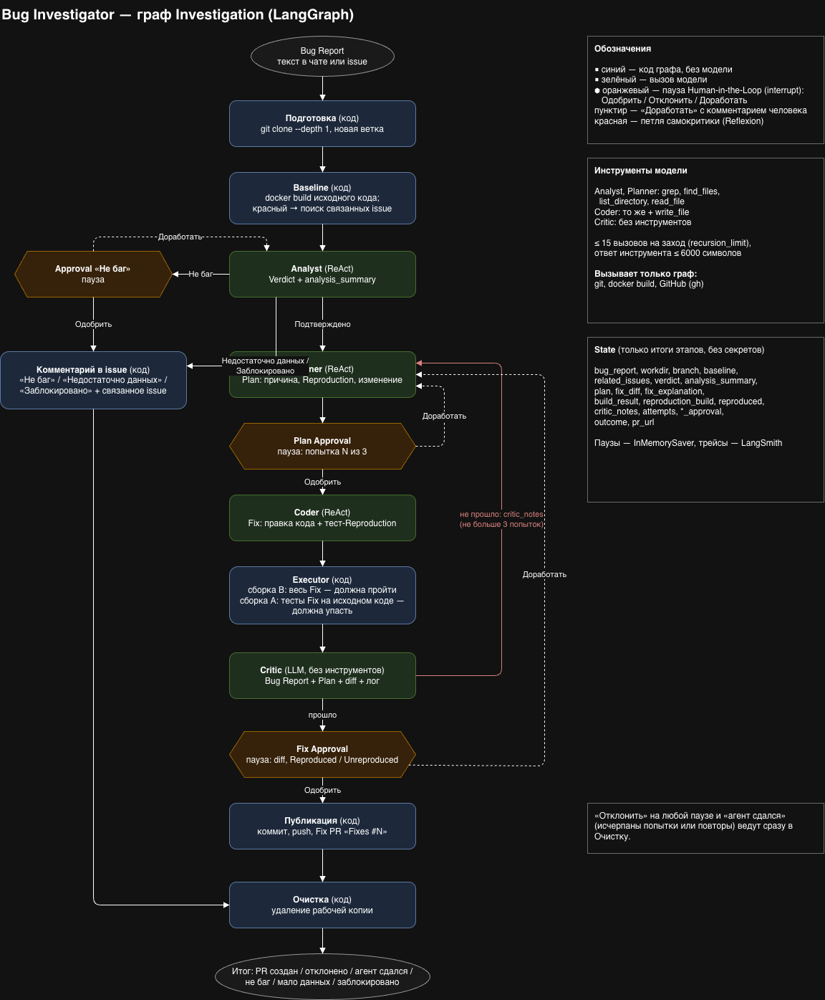

# Bug Investigator

Агент получает Bug Report (текст или ссылку на GitHub issue), находит причину в Target Repository, готовит Fix, проверяет его сборкой с тестами в Docker и после одобрения человека открывает Fix PR. Мержит всегда человек.

## Флоу



- Порядок этапов жёсткий, маршрутизация — в коде, а не в модели ([ADR 0001](docs/adr/0001-fixed-agent-pipeline.md)).
- Fix проверяется через `docker build` Target Repository: сборка с Fix должна пройти, а тесты из Fix на исходном коде должны упасть. Тогда Fix — Reproduced, иначе — Unreproduced ([ADR 0002](docs/adr/0002-verification-via-docker-build.md)).
- Оранжевые шестиугольники — паузы: «Одобрить», «Отклонить», «Доработать» с комментарием.

Подробнее: исходник схемы — [`Bug Investigator.drawio.xml`](Bug%20Investigator.drawio.xml), термины — [`GLOSSARY.md`](GLOSSARY.md), материалы к защите — [`docs/defense.md`](docs/defense.md).

## Запуск

Нужны Python 3.13, [uv](https://docs.astral.sh/uv/), запущенный Docker и [`gh`](https://cli.github.com/), авторизованный в Target Repository (`gh auth login`), с правом push.

```bash
uv sync
cp .env.example .env    # уже настроен на демо-стенд: впишите OPENAI_API_KEY и LANGSMITH_API_KEY
uv run chainlit run src/bug_investigator/ui.py    # http://localhost:8000
```

Или из терминала: `uv run bug-investigator --issue https://github.com/<owner>/<repo>/issues/1`.

**Провайдер.** Берите OpenAI (`BI_PROVIDER=openai`) или платный тариф Groq. На бесплатных тарифах Investigation упирается в лимит токенов в минуту и не доходит до конца. Полный прогон трёх багов на OpenAI стоил около $1.

**Target Repository** должен иметь в корне `Dockerfile`, который компилирует проект и прогоняет тесты (для Maven — `mvn package` без `-DskipTests`). Тесты не должны требовать внешних сервисов и должны лежать под `src/test/**`.

Остальные настройки (лимиты, таймауты, LangSmith) — в [`.env.example`](.env.example).

## Демо-стенд

[`angryelizar/resourceBooking`](https://github.com/angryelizar/resourceBooking) — Spring Boot сервис бронирования с тестами на H2 и готовым Dockerfile. На нём агента удобно гонять и отлаживать. Сделайте форк и укажите его в `BI_TARGET_REPO`.

- `main` чистый и зелёный, на нём тег `clean`.
- Ветки `bugset-1` … `bugset-4` — наборы по три бага: явный (валит существующий тест), тихий, на который можно написать тест, и тихий, на который тест не написать.
- Загрузить набор: влить ветку в `main` и запушить. Сбросить стенд: `git reset --hard clean && git push --force origin main`, открытые Fix PR закрыть.

**Откуда брать задачи:**
- Готовые issue для `bugset-1` и `bugset-2` уже есть в [issues стенда](https://github.com/angryelizar/resourceBooking/issues) — передайте агенту ссылку на любое из них.
- Черновики этих issue — в [`.scratch/bug-investigator/scenario-issues.md`](.scratch/bug-investigator/scenario-issues.md). Там же шпаргалка, где спрятан каждый баг всех четырёх наборов. Не показывайте её агенту и тому, кто пишет issue.
- Свои issue пишите как пользователь: что сделал, что ожидал, что получил. Без имён классов и методов, иначе это проверка не поиска, а чтения.
- Явный баг можно подать без issue: вставьте в чат вывод упавшего теста из `docker build`.
